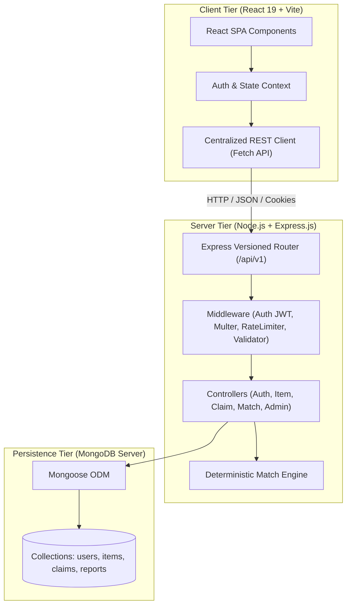
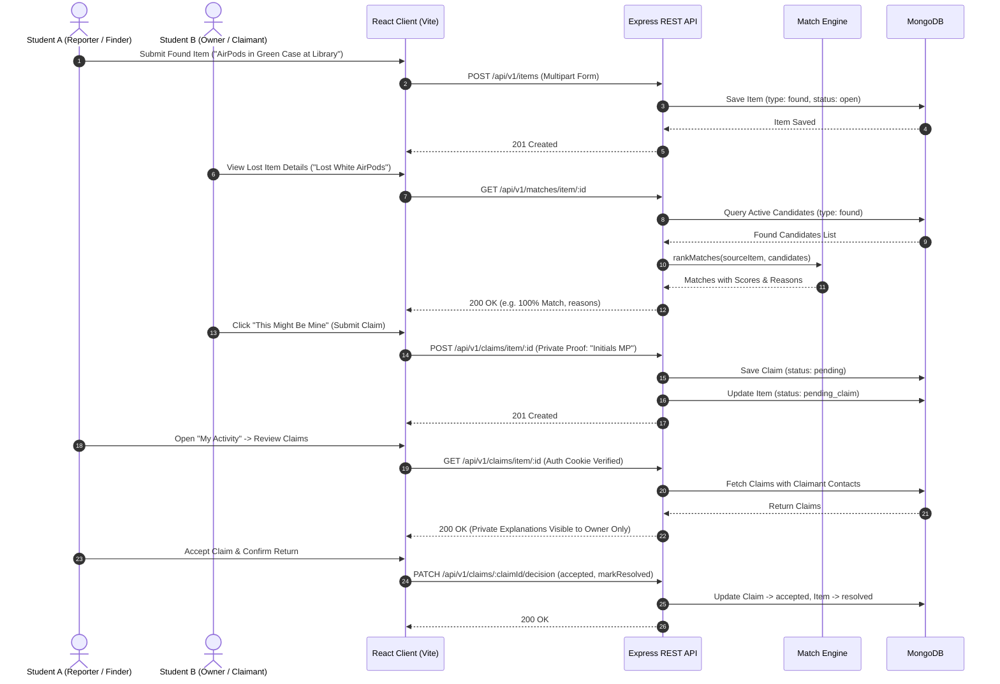

# Project Report: Campus Lost & Found Web Application

**Course / Project Title:** Full-Stack Web Development & System Design  
**Project Name:** Campus Lost & Found  
**Stack:** MERN (MongoDB, Express.js, React.js, Node.js, Mongoose, Vite)  
**Date:** November 2026  

---

## 1. Abstract & Problem Statement

### 1.1 Abstract
Across large university campuses with thousands of daily visitors across academic buildings, libraries, sports facilities, and dining commons, personal belongings are frequently misplaced. Traditional lost-and-found systems in colleges are heavily fragmented: physical drop boxes at individual department offices, unmonitored bulletin boards, or unmoderated social media threads. This lack of centralization causes prolonged recovery times, loss of valuable academic supplies and electronics, and privacy risks when students post personal contact information publicly.

The **Campus Lost & Found** application provides a centralized, secure, privacy-first web platform tailored to college communities. Built using the authentic **MERN** stack, it empowers students to report lost or found belongings, filter listings by campus building and date, receive instant **deterministic match suggestions**, and submit confidential ownership claims. Item finders review claims privately before arranging a return, and campus administrators have moderation tools to protect community integrity.

### 1.2 Problem Statement
1. **Fragmentation:** Inquiries require physical visits to multiple department front desks and campus security posts.
2. **Privacy Vulnerabilities:** Public social media lost-and-found boards often expose students' personal phone numbers, emails, and student IDs to harassment and spam.
3. **Fraudulent Claims:** Publicly displaying exact serial numbers, stickers, and identifying marks enables dishonest individuals to falsely claim valuable belongings like laptops and wireless earbuds.
4. **Lack of Automated Correlation:** Students who lose items rarely connect with the exact person who found them without an automated matching engine.

---

## 2. Objectives & Scope

### 2.1 Project Objectives
- Build a responsive, accessible single-page application using React and Vite with a warm, calm campus visual identity.
- Implement an Express.js and Node.js REST API with versioned endpoints (`/api/v1`).
- Provide MongoDB persistence with Mongoose schemas, data validation, and optimized compound indexes.
- Create a fully transparent, explainable **deterministic matching algorithm** that pairs lost and found reports without external AI APIs.
- Protect student privacy by isolating verification proofs to private channels between claimants, reporters, and staff.
- Implement role-based access control (RBAC) ensuring students cannot escalate privileges or manipulate others' reports.

### 2.2 Scope & Boundaries
- **In Scope:**
  - Student registration and sign-in with HTTP-only JWT cookies and bcrypt hashing.
  - Multi-attribute search and filtering (keyword, type, category, campus zone, date range, status).
  - Report creation with optional photo upload and distinguishing details.
  - Ownership claims workflow with private claimant proof and finder acceptance/rejection.
  - Owner lifecycle controls (edit, close, mark resolved upon item return).
  - Deterministic match scoring engine evaluating category, campus zone, date proximity, and keyword overlap.
  - Admin dashboard with real-time operational counts, listing visibility controls, and content flag moderation.
- **Out of Scope (By Design):**
  - Paid external AI/ML APIs (deterministic heuristics used instead).
  - Payment transactions or financial bounties.
  - Real-time chat (direct, safe in-person meeting coordination enabled through accepted claims).
  - External map tile APIs (campus building and zone taxonomy used instead).

---

## 3. MERN Architecture & Data Flow

### 3.1 Architectural Overview
The application follows a standard three-tier MERN client-server architecture:



### 3.2 End-to-End Claim & Match Data Flow



---

## 4. Database Models & Schema Design

All models are implemented using Mongoose schemas with strict types, field validations, and compound indexes.

### 4.1 User Schema (`User.js`)
- `name`: String, required, trimmed, 2–60 characters.
- `email`: String, required, unique, lowercase, regex-validated college email.
- `password`: String, required, minlength 6, stored exclusively as a bcrypt hash (`select: false`).
- `role`: String, enum: `['student', 'admin']`, default: `'student'`.
- `studentId`: String, optional student identification number.
- `phone`: String, optional contact number (exchanged only upon accepted claim).
- `timestamps`: Automatic `createdAt` and `updatedAt`.
- **Security:** Pre-save middleware automatically hashes passwords when created or modified.

### 4.2 Item Schema (`Item.js`)
- `owner`: ObjectId ref `User`, required, indexed.
- `type`: String, enum: `['lost', 'found']`, required, indexed.
- `title`: String, required, trimmed, 3–100 characters.
- `description`: String, required, trimmed, 5–2000 characters.
- `category`: String, enum of 9 campus categories, indexed.
- `campusLocation`: String, enum of 11 university zones/buildings, indexed.
- `locationDetails`: String, optional specific notes (e.g. "Carrel #24, 2nd floor").
- `eventDate`: Date, required, indexed.
- `identifyingDetails`: String, optional proof marks or distinguishing features.
- `imageUrl`: String, local file path under `/uploads/`.
- `status`: String, enum: `['open', 'pending_claim', 'resolved', 'closed']`, default: `'open'`.
- `isModeratedHidden`: Boolean, default: `false`, indexed for public feed exclusion.
- `moderationReason`: String, note from moderator if hidden.
- `resolvedAt`: Date, timestamp of resolution.
- `resolvedClaim`: ObjectId ref `Claim`, link to winning claim.
- **Indexes:**
  - Compound: `{ type: 1, status: 1, isModeratedHidden: 1, createdAt: -1 }`
  - Category & Location: `{ category: 1, campusLocation: 1 }`
  - Text: `{ title: 'text', description: 'text', locationDetails: 'text' }`

### 4.3 Claim Schema (`Claim.js`)
- `item`: ObjectId ref `Item`, required, indexed.
- `claimant`: ObjectId ref `User`, required, indexed.
- `explanation`: String, required (private proof: serial numbers, lock screens, internal contents).
- `contactNote`: String, optional claimant meeting preferences.
- `status`: String, enum: `['pending', 'accepted', 'rejected']`, default: `'pending'`.
- `ownerDecisionReason`: String, decision feedback from the listing owner.
- `decidedAt`: Date, timestamp of owner decision.
- **Privacy Guarantee:** The `explanation` field is never populated on public item queries and is strictly guarded by server-side authorization.

### 4.4 Report Schema (`Report.js`)
- `reporter`: ObjectId ref `User`, required, indexed.
- `item`: ObjectId ref `Item`, required, indexed.
- `reason`: String, enum: `['inappropriate_content', 'duplicate_listing', 'spam_or_fake', 'privacy_violation', 'harassment', 'other']`.
- `details`: String, optional elaboration.
- `status`: String, enum: `['pending', 'reviewed', 'dismissed', 'action_taken']`.
- `adminNotes`: String, staff resolution notes.
- `reviewedBy`: ObjectId ref `User`, administrator reference.
- `reviewedAt`: Date.

---

## 5. API Modules & Endpoints

All endpoints are grouped under `/api/v1`:

1. **Authentication (`/api/v1/auth`)**
   - `POST /register`: Rate-limited student registration. Role is locked to `'student'`.
   - `POST /login`: Rate-limited authentication; issues HTTP-only JWT cookie.
   - `POST /logout`: Clears cookie.
   - `GET /me`: Hydrates current user session.

2. **Items (`/api/v1/items`)**
   - `GET /`: Search and filter with pagination. Excludes moderated/hidden items.
   - `GET /my`: Retrieves authenticated user's reported items with received claim counts.
   - `GET /:id`: Retrieves single item details. Enforces privacy rules.
   - `POST /`: Creates report with optional multipart image upload.
   - `PUT /:id`: Updates item details (verified for owner or admin only).
   - `PATCH /:id/close`: Updates item status to `'closed'` or `'resolved'`.

3. **Deterministic Match Engine (`/api/v1/matches`)**
   - `GET /item/:itemId`: Computes match candidates with confidence score and reasons.
   - `GET /my-matches`: Aggregates matches for all active reports owned by the logged-in student.

4. **Claims (`/api/v1/claims`)**
   - `POST /item/:itemId`: Submits claim with private explanation. Rejects self-claiming.
   - `GET /my-claims`: Retrieves user's submitted claims with owner contacts if accepted.
   - `GET /item/:itemId`: Authorizes owner or admin only; returns private claim submissions.
   - `PATCH /:claimId/decision`: Allows owner to accept or reject claim and resolve item.

5. **Content Moderation (`/api/v1/reports`)**
   - `POST /item/:itemId`: Flags inappropriate, duplicate, or spam listings.

6. **Administration (`/api/v1/admin`)**
   - `GET /stats`: Returns system counters.
   - `GET /listings`: Lists all items including hidden entries.
   - `PATCH /listings/:itemId/hide`: Moderates item visibility.
   - `GET /reports`: Lists pending and reviewed content flags.
   - `PATCH /reports/:reportId`: Moderates flagged report and optionally hides offending listing.
   - `GET /users`: Directory of registered students.

---

## 6. Deterministic Matching Engine

The match engine (`matchService.js`) calculates a score from 0 to 100 based on 4 transparent rules:

$$\text{Total Score} = \text{Score}_{\text{Category}} + \text{Score}_{\text{Location}} + \text{Score}_{\text{Date}} + \text{Score}_{\text{Keywords}}$$

1. **Opposite Type Constraint:**
   - If $\text{Type}_{\text{source}} == \text{Type}_{\text{candidate}}$, $\text{Total Score} = 0$.
2. **Category Weight (35%):**
   - If $\text{Category}_{\text{source}} == \text{Category}_{\text{candidate}}$, $+35\text{ pts}$.
3. **Location Weight (Up to 25%):**
   - Exact location match: $+25\text{ pts}$.
   - Nearby campus zone match (e.g., *Science Complex* and *Computer Science Lab*): $+15\text{ pts}$.
4. **Date Proximity (Up to 20%):**
   - $\le 1\text{ day apart}$: $+20\text{ pts}$.
   - $\le 3\text{ days apart}$: $+15\text{ pts}$.
   - $\le 7\text{ days apart}$: $+10\text{ pts}$.
   - $\le 14\text{ days apart}$: $+5\text{ pts}$.
5. **Keyword Overlap (Up to 20%):**
   - Texts are normalized and filtered against a stopword set of 90+ common English words.
   - $3+\text{ shared keywords}$: $+20\text{ pts}$.
   - $2\text{ shared keywords}$: $+14\text{ pts}$.
   - $1\text{ shared keyword}$: $+8\text{ pts}$.

A threshold of $25\text{ pts}$ is applied. Every match includes a human-readable list of reasons explaining exactly why it was suggested.

---

## 7. Security & Validation Practices

- **Role Tampering Prevention:** `validateRegister` explicitly removes `req.body.role` before processing. Admins can only be initialized via environment-gated seeds.
- **Ownership Verification:** Every mutation route queries the target document and asserts `item.owner.equals(req.user._id) || req.user.role === 'admin'`. Unauthorized users receive HTTP 403 Forbidden.
- **Self-Claiming Prevention:** `submitClaim` verifies `item.owner.toString() !== req.user._id.toString()`.
- **Upload Hardening:** Multer storage uses sanitized unique filenames (`item-<timestamp>-<random>.<ext>`), checks file MIME types (`image/jpeg`, `image/png`, `image/webp`), and enforces a 5MB limit.
- **Rate Limiting:** `authLimiter` restricts IP requests to 60 per 15-minute window to mitigate credential stuffing attacks.
- **Credential Storage:** JWT stored in HTTP-only cookies with `sameSite: 'lax'` to defend against XSS.

---

## 8. Setup & Execution Steps

### Step 1: Environment Setup
Ensure Node.js (v18+) and MongoDB are installed and active.

### Step 2: Install Dependencies
```bash
npm run install:all
```

### Step 3: Configure Environment Variables
Copy `.env.example` to `.env` in `server/`:
```ini
PORT=5000
NODE_ENV=development
CLIENT_ORIGIN=http://localhost:5173
MONGO_URI=mongodb://127.0.0.1:27017/campus_lost_and_found
JWT_SECRET=super_secret_dev_key_campus_lost_found_2026
JWT_EXPIRES_IN=7d
MAX_FILE_SIZE_MB=5
```

### Step 4: Seed Demo Data
```bash
npm run seed
```

### Step 5: Start Development Servers
```bash
# Terminal 1: Backend API
npm run dev:server

# Terminal 2: React Frontend (Vite)
npm run dev:client
```
Visit `http://localhost:5173`.

### Step 6: Production Build & Single-Port Serve
```bash
npm run build:client
npm start
```
Visit `http://localhost:5000`.

---

## 9. Testing Performed & Results

The automated test suite uses Node's native test runner (`node:test`, `node:assert`) with `supertest`:

```bash
npm test
```

### Summary of Executed Tests:
```
▶ Auth API Tests (/api/v1/auth)
  ✔ POST /register should reject invalid inputs with 400
  ✔ POST /register should successfully create a student and set cookie
  ✔ POST /register must not allow caller to set role to admin
  ✔ POST /login should reject wrong credentials with 401
  ✔ POST /login with correct password returns token and user data
  ✔ GET /me requires authentication
  ✔ GET /me succeeds with valid Bearer token
✔ Auth API Tests (7/7 passed)

▶ Claims API Tests (/api/v1/claims)
  ✔ POST /item/:itemId rejects owner claiming their own item
  ✔ POST /item/:itemId allows another student to submit claim with explanation
  ✔ GET /item/:itemId forbids unrelated third-party students from reading private claims
  ✔ GET /item/:itemId allows listing owner to review claims privately
  ✔ PATCH /:claimId/decision allows owner to accept claim and mark resolved
✔ Claims API Tests (5/5 passed)

▶ Items API Tests (/api/v1/items)
  ✔ GET / returns public items with pagination
  ✔ POST / requires authentication
  ✔ POST / creates a new item with valid authenticated student
  ✔ PUT /:id forbids non-owners from editing (403 Forbidden)
  ✔ PUT /:id allows owner to update listing details
  ✔ PATCH /:id/close allows owner to close listing
✔ Items API Tests (6/6 passed)

▶ Deterministic Match Suggestion Logic Tests
  ✔ extractKeywords should tokenize, lowercase and filter stopwords
  ✔ calculateMatchScore returns 0 for identical item types (lost vs lost)
  ✔ calculateMatchScore accumulates points for category, location, date, and keywords
  ✔ rankMatches filters out low scores (<25) and items with same owner
✔ Deterministic Match Suggestion Logic Tests (4/4 passed)

Total: 22 tests across 4 suites, 22 passed, 0 failed.
```

---

## 10. Limitations & Future Improvements

### 10.1 Limitations
- **Local Storage of Uploads:** Images are currently stored on the local file system (`server/uploads/`). In a distributed production deployment across multiple server nodes, an object storage service (such as S3 or MinIO) would be appropriate.
- **Email Notifications:** The system provides in-app status updates in the *My Activity* dashboard. Automated SMTP/transactional email notifications when a claim is accepted or a match is discovered could be added.
- **Physical Handover Protocol:** In-person return verification relies on mutual agreement between students. High-value belongings would benefit from an official campus security drop-off desk option.

### 10.2 Future Improvements
- **Campus Card SSO:** Integrate SAML/CAS/OAuth2 Single Sign-On using existing university student identity providers.
- **Barcode / Student ID Scanner:** Add barcode/QR code scanning for recovered campus student ID cards to automatically notify the enrolled student.
- **Printable Turn-In Slips:** Allow finders to generate and print a standardized paper turn-in receipt to attach to physical items deposited at campus front desks.
