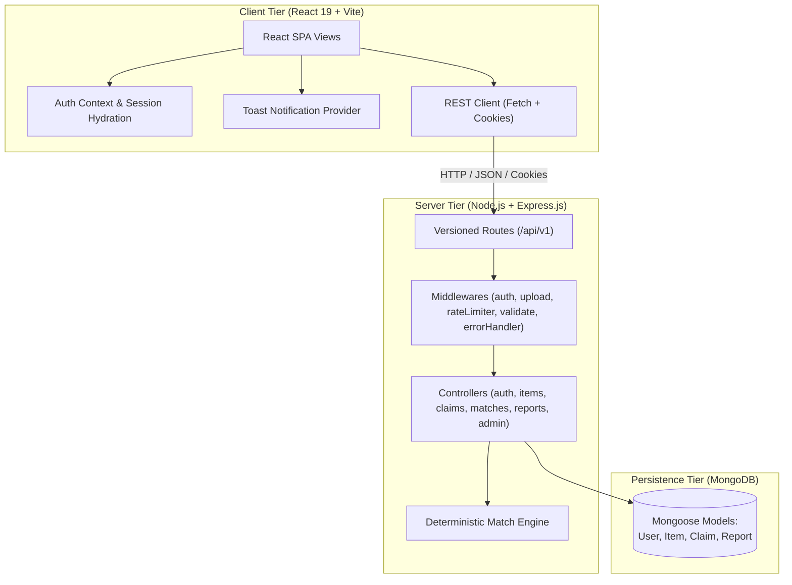

# 🎓 Campus Lost & Found — Full-Stack MERN Portal

<div align="center">


<p align="center">
  <strong>A modern, responsive, privacy-first web application designed for university campuses to report, track, match, and reclaim lost belongings.</strong>
</p>

[Key Features](#-key-features) •
[Tech Stack](#-tech-stack) •
[System Architecture](#-system-architecture) •
[Deterministic Match Engine](#-deterministic-matching-engine) •
[Quickstart Guide](#-quickstart--installation) •
[Demo Accounts](#-demo-accounts-for-evaluation) •
[API Specification](#-rest-api-specification) •
[Pushing to GitHub](#-pushing-to-github)

</div>

---

## 🌟 Key Features

### 👤 Student & Community Experience
- **Instant Search & Multi-Filter Engine:** Debounced keyword search across titles, descriptions, and campus locations. Filter by item type (*Lost* or *Found*), 9 campus categories, 11 campus buildings/zones, status, and date range.
- **Popular Search Chips:** Quick-filter chips for high-frequency campus belongings (*AirPods*, *Hydro Flask*, *Student ID*, *Backpack*, *Keys*, *Calculator*).
- **Flexible View Modes:** Toggle dynamically between a rich **Card Grid View** (with photo previews and badges) and a dense **Compact List View** for rapid visual scanning.
- **Sorting Options:** Sort listings by *Most Recent Post*, *Oldest Post*, *Incident Date (Newest first)*, or *Incident Date (Oldest first)*.
- **Detailed Item Reporting:** Submit lost or found reports with item title, category, campus location, location notes, incident date, public description, optional private identifying proof, and photo upload (JPEG, PNG, WebP up to 5MB).
- **Interactive Match Suggestions & Side-by-Side Inspector:** Automatic heuristic match recommendations with confidence scores (0–100%), transparent reasons, and a **Side-by-Side Comparison Modal** comparing items with category, location, date, and keyword meters.
- **Active Campus Hotspots Directory:** Interactive widget visualizing live active report counts across campus buildings (*Main Library*, *Dining Commons*, *Science Complex*, etc.) with 1-click filtering.
- **Recent Reunifications Showcase:** Live community showcase celebrating recently returned belongings.
- **Confidential Claims:** Submit claims with private proof of ownership (serial numbers, lock screen wallpapers, engravings) that are strictly hidden from public view.
- **In-App Toast System:** Animated, non-intrusive toast notifications for feedback on claims, edits, status updates, and clipboard actions.
- **Printable Campus Notice Flyer:** 1-click generation of official, university-branded printable physical notice flyers formatted for standard 8.5" &times; 11" paper or PDF export (`@media print` styled).
- **My Activity Dashboard:** Dedicated hub with three tabbed views for *My Reports* (with received claim counts and management actions), *My Claims* (with approval status and owner contact exchange upon acceptance), and *Possible Matches*.

### 🔑 Listing Owner Controls
- **Private Claim Review:** Privately inspect claimant ownership proofs and verified student contacts without exposing sensitive details to the public.
- **Decision Workflow:** Accept claims to coordinate physical item handoff or reject false claims with explanatory feedback notes.
- **Lifecycle Management:** Edit listing details, mark items as resolved upon return, or close listings.

### 🛡️ Campus Administrator Moderation (`/admin`)
- **Staff-Only Access:** Guarded by strict role-based access control (`role: 'admin'`). Role tampering is blocked during registration.
- **Live Operations Dashboard:** Counters for open listings, pending claims, resolved items, hidden posts, content flags, and registered students.
- **Listing Visibility Controls:** Temporarily hide inappropriate or violating listings from the public feed with audit notes, or restore them.
- **Flagged Content Review:** Review student-submitted reports (spam, offensive material, duplicate posts) and take moderation action.
- **Student Directory:** Directory of registered student accounts.

---

## 🛠 Tech Stack

| Layer | Technology | Description |
| :--- | :--- | :--- |
| **Frontend** | React 19, Vite 6 | Fast modern Single-Page Application (SPA) with HMR |
| **Styling** | Tailwind CSS v3.4 | Custom university theme (Warm off-white `#FBFBF9`, Deep navy `#0F172A`, Teal accents `#0D9488`) |
| **Icons** | Lucide React | Consistent, lightweight SVG icon system |
| **Routing** | React Router DOM v7 | Client-side routing with protected route guards |
| **Backend Runtime** | Node.js v24+ | Server-side JavaScript runtime (ES Modules) |
| **Framework** | Express.js 4.x | Versioned REST API (`/api/v1`) with centralized error handling |
| **Database** | MongoDB & Mongoose | Document persistence with schema validation & compound indexes |
| **Authentication** | JWT & bcryptjs | HTTP-only cookie-based authentication with bcrypt password hashing (salt = 10) |
| **Uploads** | Multer | Local disk storage with MIME whitelisting (`image/jpeg`, `image/png`, `image/webp`) and 5MB size limit |
| **Testing** | Node Native Test Runner | Automated tests via `node:test` & `supertest` |

---

## 📐 System Architecture



---

## ⚡ Deterministic Matching Engine

The application does **not** rely on external black-box AI APIs or paid cloud services. Matching is computed using an **explainable, deterministic rule engine** (`server/src/services/matchService.js`).

$$\text{Match Score} = \text{Score}_{\text{Category}} + \text{Score}_{\text{Location}} + \text{Score}_{\text{Date}} + \text{Score}_{\text{Keywords}}$$

| Rule | Weight | Evaluation Criteria |
| :--- | :---: | :--- |
| **Opposite Type Constraint** | Hard Filter | *Lost* items only match *Found* items, and vice versa. Identical types receive 0 points. |
| **Category Match** | 35 pts | Exact category match (e.g. *Electronics* matches *Electronics*). |
| **Location Proximity** | Up to 25 pts | Exact building match = **+25 pts**; Nearby campus zone cluster (e.g. Science Complex & CS Lab) = **+15 pts**. |
| **Date Proximity** | Up to 20 pts | &le; 1 day = **+20 pts**; &le; 3 days = **+15 pts**; &le; 7 days = **+10 pts**; &le; 14 days = **+5 pts**. |
| **Keyword Overlap** | Up to 20 pts | Text tokenized and filtered against a 90+ English stopword set. 1 shared word = **+8 pts**, 2 words = **+14 pts**, 3+ words = **+20 pts**. |

Candidate items scoring &ge; 25 points are presented with an exact confidence percentage and human-readable explanation bullets (*"Same category: Electronics"*, *"Exact location match: Main Library"*, *"Dates within 24 hours"*).

---

## 📂 Project Structure

```
Lost And Found/
├── client/                                # React Frontend (Vite)
│   ├── index.html                         # Entry HTML with university meta
│   ├── vite.config.js                     # Vite proxy for /api and /uploads
│   ├── tailwind.config.js                 # Campus visual palette configuration
│   ├── package.json                       # Client dependencies
│   └── src/
│       ├── main.jsx                       # App bootstrap
│       ├── App.jsx                        # Routing and global layout
│       ├── index.css                      # Base Tailwind styles & print CSS
│       ├── api/client.js                  # Centralized REST API client
│       ├── context/
│       │   ├── AuthContext.jsx            # User authentication state
│       │   └── ToastContext.jsx           # In-app toast notification system
│       ├── hooks/
│       │   └── useDebounce.js             # Custom search debounce hook
│       ├── components/                    # Reusable UI widgets
│       │   ├── Navbar.jsx                 # Navigation header with responsive drawer
│       │   ├── Footer.jsx                 # University footer with campus links
│       │   ├── ItemCard.jsx               # Item card with designed graphic fallback
│       │   ├── CampusHotspots.jsx         # Interactive campus building directory
│       │   ├── RecentRecoveries.jsx       # Resolved items community showcase
│       │   ├── MatchBadge.jsx             # Score badge & reason list
│       │   ├── MatchCompareModal.jsx      # Side-by-side match inspector
│       │   ├── PrintFlyerModal.jsx        # Printable notice flyer generator
│       │   ├── ClaimModal.jsx             # Confidential proof submission modal
│       │   ├── ReportModal.jsx            # Inappropriate content report modal
│       │   ├── ReviewClaimsModal.jsx      # Owner claim evaluation drawer
│       │   └── ConfirmModal.jsx           # Reusable confirmation dialog
│       └── pages/                         # Core views
│           ├── BrowsePage.jsx             # Search, sort, filter chips & feed
│           ├── ItemDetailPage.jsx         # Details, owner actions & matches
│           ├── CreateReportPage.jsx       # Report submission with image upload
│           ├── EditReportPage.jsx         # Listing edit & lifecycle updates
│           ├── MyActivityPage.jsx         # Reports, claims & matches dashboard
│           ├── AdminDashboardPage.jsx     # Staff moderation panel & metrics
│           ├── LoginPage.jsx              # Sign in with demo fast-fill buttons
│           └── RegisterPage.jsx           # Student registration
├── server/                                # Express + Node.js Backend
│   ├── package.json                       # Server scripts and dependencies
│   ├── .env.example                       # Server environment template
│   ├── uploads/                           # Local storage directory for uploads
│   ├── src/
│   │   ├── server.js                      # Server entry point (port 5000)
│   │   ├── app.js                         # Middleware, routes & static serve
│   │   ├── config/db.js                   # Mongoose MongoDB connection
│   │   ├── models/                        # User, Item, Claim, Report
│   │   ├── middleware/                    # auth, upload, rateLimiter, validate, errorHandler
│   │   ├── services/matchService.js       # Deterministic matching algorithm
│   │   ├── controllers/                   # auth, item, claim, match, report, admin
│   │   ├── routes/                        # Versioned Express routes (/api/v1)
│   │   └── seed/seed.js                   # Database seeding script
│   └── tests/                             # Automated integration & unit tests
│       ├── auth.test.js
│       ├── items.test.js
│       ├── claims.test.js
│       └── matches.test.js
├── .env.example                           # Root environment template
├── .gitignore                             # Clean git exclusions
├── LICENSE                                # MIT License
├── package.json                           # Root convenience scripts
├── README.md                              # Main documentation guide
└── PROJECT_REPORT.md                      # Academic project submission report
```

---

## 🚀 Quickstart & Installation

### Prerequisites
- **Node.js:** v18.0.0 or later (v24 recommended)
- **npm:** v9.0.0 or later
- **MongoDB:** MongoDB Community Server running locally on port `27017` (or MongoDB Atlas URI)

### 1. Install Dependencies
```bash
npm run install:all
```

### 2. Configure Environment (`server/.env`)
Copy the template in `server/.env.example` to `server/.env`:
```ini
PORT=5000
NODE_ENV=development
CLIENT_ORIGIN=http://localhost:5173
MONGO_URI=mongodb://127.0.0.1:27017/campus_lost_and_found
JWT_SECRET=super_secret_dev_key_campus_lost_found_2026
JWT_EXPIRES_IN=7d
MAX_FILE_SIZE_MB=5
```

### 3. Seed Database
```bash
npm run seed
```

### 4. Start in Development Mode
```bash
# Terminal 1: Backend Server (http://localhost:5000)
npm run dev:server

# Terminal 2: Frontend Client (http://localhost:5173 with proxy)
npm run dev:client
```
Open **[http://localhost:5173](http://localhost:5173)** in your browser.

### 5. Production Build & Single-Port Serve
```bash
# 1. Build the frontend client
npm run build:client

# 2. Run the unified production server on port 5000
npm start
```
Open **[http://localhost:5000](http://localhost:5000)** (the Express server serves the compiled React app and the REST API concurrently on port 5000).

---

## 👥 Demo Accounts for Evaluation

Quick-click demo autofill buttons are provided directly on the **[Sign In Screen](http://localhost:5000/login)**:

| Role | Name | Email | Password | Scenario |
| :--- | :--- | :--- | :--- | :--- |
| **Student 1** | Maya Patel | `maya.patel@campus.edu` | `StudentPass123!` | Lost AirPods in Main Library; has claim on found backpack. |
| **Student 2** | Marcus Chen | `marcus.chen@campus.edu` | `StudentPass123!` | Found AirPods in Main Library (100% Match with Maya); lost Student ID. |
| **Student 3** | Elena Rostova | `elena.rostova@campus.edu` | `StudentPass123!` | Lost blue Hydro Flask bottle in Dining Commons. |
| **Admin** | Campus Admin | `admin@campus.edu` | `AdminPass2026!` | Access to the protected `/admin` moderation suite. |

---

## 🧪 Automated Tests

Execute the automated test suite powered by Node's native test runner (`node:test`) and `supertest`:

```bash
npm test
```

### Test Suite Execution Output:
```
▶ Auth API Tests (/api/v1/auth)
  ✔ POST /register should reject invalid inputs with 400
  ✔ POST /register should successfully create a student and set cookie
  ✔ POST /register must not allow caller to set role to admin
  ✔ POST /login should reject wrong credentials with 401
  ✔ POST /login with correct password returns token and user data
  ✔ GET /me requires authentication
  ✔ GET /me succeeds with valid Bearer token
✔ Auth API Tests (7/7 passed)

▶ Claims API Tests (/api/v1/claims)
  ✔ POST /item/:itemId rejects owner claiming their own item
  ✔ POST /item/:itemId allows another student to submit claim with explanation
  ✔ GET /item/:itemId forbids unrelated third-party students from reading private claims
  ✔ GET /item/:itemId allows listing owner to review claims privately
  ✔ PATCH /:claimId/decision allows owner to accept claim and mark resolved
✔ Claims API Tests (5/5 passed)

▶ Items API Tests (/api/v1/items)
  ✔ GET / returns public items with pagination
  ✔ POST / requires authentication
  ✔ POST / creates a new item with valid authenticated student
  ✔ PUT /:id forbids non-owners from editing
  ✔ PUT /:id allows owner to update listing details
  ✔ PATCH /:id/close allows owner to close listing
✔ Items API Tests (6/6 passed)

▶ Deterministic Match Suggestion Logic Tests
  ✔ extractKeywords should tokenize, lowercase and filter stopwords
  ✔ calculateMatchScore returns 0 for identical item types (lost vs lost)
  ✔ calculateMatchScore accumulates points for category, location, date, and keywords
  ✔ rankMatches filters out low scores (<25) and items with same owner
✔ Deterministic Match Suggestion Logic Tests (4/4 passed)

Total: 22 tests across 4 test suites (100% passing, 0 failures).
```

---

## 📡 REST API Specification

All routes are versioned under `/api/v1`:

### Authentication (`/api/v1/auth`)
| Method | Endpoint | Access | Description |
| :--- | :--- | :--- | :--- |
| `POST` | `/register` | Public | Register new student account (forces role: `student`) |
| `POST` | `/login` | Public | Authenticate user & issue HTTP-only JWT cookie |
| `POST` | `/logout` | Public | Clear session cookie |
| `GET` | `/me` | Private | Return current authenticated user profile |

### Items (`/api/v1/items`)
| Method | Endpoint | Access | Description |
| :--- | :--- | :--- | :--- |
| `GET` | `/` | Public | List and search items with pagination, filters, and sorting |
| `GET` | `/hotspots` | Public | Aggregated item counts grouped by campus location |
| `GET` | `/recoveries` | Public | Recently resolved/reunited belongings showcase |
| `GET` | `/my` | Private | Retrieve items reported by current authenticated user |
| `GET` | `/:id` | Public | Get full listing details and owner information |
| `POST` | `/` | Private | Create lost or found report (supports multipart image) |
| `PUT` | `/:id` | Private (Owner/Admin) | Update listing details or replace photo |
| `PATCH` | `/:id/close` | Private (Owner/Admin) | Update listing status to closed or resolved |

### Match Engine (`/api/v1/matches`)
| Method | Endpoint | Access | Description |
| :--- | :--- | :--- | :--- |
| `GET` | `/item/:itemId` | Public | Return ranked deterministic match candidates for item |
| `GET` | `/my-matches` | Private | Aggregate matches for all active reports by current user |

### Claims (`/api/v1/claims`)
| Method | Endpoint | Access | Description |
| :--- | :--- | :--- | :--- |
| `POST` | `/item/:itemId` | Private | Submit ownership claim with private proof |
| `GET` | `/my-claims` | Private | List claims submitted by the current user |
| `GET` | `/item/:itemId` | Private (Owner/Admin) | Privately review all claims submitted for an item |
| `PATCH`| `/:claimId/decision`| Private (Owner/Admin)| Accept or reject claim with optional resolution |

### Content Moderation (`/api/v1/reports`)
| Method | Endpoint | Access | Description |
| :--- | :--- | :--- | :--- |
| `POST` | `/item/:itemId` | Private | Flag an inappropriate, duplicate, or spam listing |

### Administrator (`/api/v1/admin`)
| Method | Endpoint | Access | Description |
| :--- | :--- | :--- | :--- |
| `GET` | `/stats` | Admin Only | System counts (open items, claims, flags, users) |
| `GET` | `/listings` | Admin Only | Administrative listing table with hidden items |
| `PATCH`| `/listings/:itemId/hide`| Admin Only | Hide or restore listing from public feed |
| `GET` | `/reports` | Admin Only | List all submitted content flags |
| `PATCH`| `/reports/:reportId` | Admin Only | Moderate report and optionally hide associated item |
| `GET` | `/users` | Admin Only | View registered campus student directory |

---

## 📤 Pushing to GitHub

The repository is organized and ready to be pushed to your GitHub repository. Follow these exact steps whenever you are ready:

### 1. Initialize Git and Stage Files
```bash
git init
git add .
git commit -m "feat: complete Campus Lost & Found MERN application"
```

### 2. Link Your Remote GitHub Repository
Replace `<YOUR_GITHUB_REPO_URL>` with your repository URL (e.g., `https://github.com/username/campus-lost-and-found.git`):

```bash
git branch -M main
git remote add origin <YOUR_GITHUB_REPO_URL>
```

### 3. Push to GitHub
```bash
git push -u origin main
```

---

## 📄 License

This project is licensed under the [MIT License](LICENSE).
